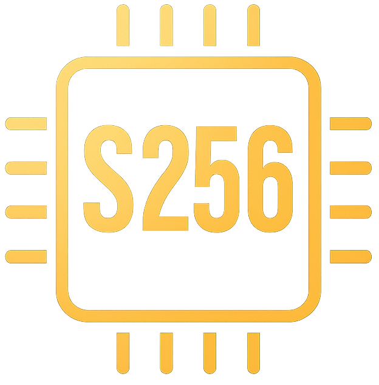

# S256 Coin Web-Wallet


A modern, secure, non-custodial web wallet for the SHA256 Coin network. Private keys remain client-side and transactions are signed locally in the browser.

<p align="center">
  
</p>

<p align="center">
  <strong>The Official Web-Wallet for SHA256coin (S256)</strong><br>
  Built with Flutter for Web
</p>

<p align="center">
  <a href="https://sha256coin.eu">Website</a> •
  <a href="https://explorer.sha256coin.eu">Explorer</a>
</p>

## Current Version

- **Release:** `v2.9`
- **Package Version:** `2.9.0` (see `pubspec.yaml`)
- **Release Notes:** `CHANGELOG.MD`

## Release Highlights (v2.9)

This release adds an address book and payment requests, shared with the S256 Android wallet.

- **Address book:** a Contacts tab with search, a contact picker in Send, and `.s256` import/export compatible with the Android wallet.
- **Payment requests:** the Receive tab makes a `sha256coin:` QR code or a link that opens the wallet with the Send form filled in. The name in a request is shown as not verified, and a request that borrows a saved contact's name gets a warning.

Earlier highlights (v2.8):

- **Server connection:** choose which RPC server the wallet uses, with a "Custom server" badge and a "Reset to default" button. See [Choosing a server](#choosing-a-server).
- **Fixed fee limits:** a wrong or dishonest server cannot make the wallet overpay.
- **Stricter CSP:** no `unsafe-inline` / `unsafe-eval` in `script-src`.
- **Trust model:** the README now describes what the wallet trusts and how to run your own server.

Earlier highlights (v2.7):

- **On-chain messages:** attach an optional note (up to 80 bytes) to a send, embedded via OP_RETURN, with a live byte counter and pre-send review since it's permanent and public.
- **Advanced send parity:** richer send flow with robust fee handling, manual fee fallback, and clear transaction result metadata.
- **Migration send parity:** stronger migration guardrails and batch migration handling.
- **Signer hardening:** improved signature normalization and safer scriptCode derivation in signing internals.
- **Session persistence controls:** optional encrypted remembered-session support with settings-level user control.

For full version history and details, see `CHANGELOG.MD`.

---

## Security Architecture

- **Client-Side Signing:** Transactions are signed locally in the browser; private keys and seed phrases are never sent to RPC endpoints.
- **Zero-Trust Broadcast:** The node receives signed transaction hex only.
- **Session Safety:** Default behavior is ephemeral session state; optional encrypted session persistence can be enabled by the user.

## Technical Stack

- **Derivation:** BIP39 mnemonic seed and BIP44 paths.
- **Cryptography:** PointyCastle + SHA256/RIPEMD160 primitives.
- **Frontend:** Flutter Web.
- **Transport:** JSON-RPC over HTTPS.

## Features

- **Seed Phrase Wallet:** 12/24-word recovery phrase support.
- **Legacy WIF Wallet:** compatibility with existing private keys.
- **Send/Receive:** standard transfer support with multiple address formats.
- **On-Chain Messages:** attach an optional public note (up to 80 bytes) to a send via OP_RETURN.
- **Coin Control:** manual UTXO selection for fee/privacy tuning.
- **Address Book & Payment Requests:** saved contacts (`.s256` import/export) and `sha256coin:` request QR codes and links.
- **Server Connection:** use the default RPC proxy or your own.
- **Network Visibility:** integrated network info and health metrics.
- **Price Tracking:** in-app S256/USD price display.

## Security Warning

Web wallets are designed for convenience, not long-term high-value storage.

- Verify you are on the correct URL: `https://sha256coin.eu`.
- Keep seed phrase/private keys offline and backed up securely.
- Treat browser environments as potentially exposed.
- Prefer hardware or offline signing workflows for larger holdings.

## Development

Run locally:

```bash
flutter run -d chrome
```

or

```bash
flutter run -d web-server --web-port 8080
```

## Build for Deployment

```bash
flutter build web --release --base-href "/web-wallet/"
```

## Trust model

The wallet is a client-side app that runs in your browser.

- **Keys stay on your device.** Seed phrases and private keys are created and used in the browser, and transactions are signed there.
- **It reads the chain through an RPC server.** The wallet asks an RPC proxy for chain data (balances, unspent coins, fees, network information) and sends it signed transactions to broadcast.
- **The server never receives your keys or seed phrase.** It does see the addresses the wallet looks up, the signed transactions, and your IP address.
- **The server is not trusted.** A dishonest server can show wrong balances or refuse to relay a transaction, but it cannot sign for you. The wallet also refuses fees above fixed limits, whatever the server reports (see [Fee limits](#fee-limits)).
- **The default server is the project's proxy**, `https://sha256coin.eu/rpc`. You can replace it with any server you trust or run yourself.

## Choosing a server

Open **Server connection** on the start screen, or in **Settings** after loading a wallet. Enter the address of the server and press **Save**. **Reset to default** is always available, and a **Custom server** badge is shown while a non-default server is in use. The setting is stored in your browser, separately from your wallet data, and can only be changed on this screen: not from links, query parameters or the URL hash.

**Address rules**

- `https://` only. The one exception is `http://localhost` and `http://127.0.0.1` (any port), for people running their own node. Safari may block plain `http://localhost` from a secure page.
- No user name or password in the address, and nothing after a `?` or `#`. Trailing slashes are removed.

**Checks before saving.** The wallet asks the server for `getblockchaininfo` and for the hash of block 0, which must be the S256 genesis block (`00000000abe2a78ceb00eca81258804d59fe4ad45345e1750e705139e6da7297`). If any check fails, your previous setting is kept and the message says why (unreachable, timed out, request refused, not a node, wrong network, or blocked by CORS).

**Not affected by this setting.** Transaction history and the pending-transaction fallback use the project's explorer (`explorer.sha256coin.eu`, `sha256coin.eu/api/mempool`), so your address is sent there even with a custom server. Price data comes from `api.livecoinwatch.com` and sends no address.

### Fee limits

Whatever the server reports, the wallet will not send a transaction if the fee rate is above 0.01 S256/kvB, or if it is above 0.0004 S256/kvB and the fee is more than 10% of the amount sent. If the server reports a rate above the limit, automatic fees are treated as unavailable and you can enter a manual fee instead; manual fees are checked against the same limits before signing.

## Backup and portability

- Back up your 12- or 24-word seed phrase, or your private key (WIF), offline. Anyone who has it controls the funds, and nobody can recover it for you.
- Your keys are not tied to this website. The private key (WIF) can be imported into S256 Core: see [IMPORT_KEY_INTO_CORE.md](IMPORT_KEY_INTO_CORE.md). Seed phrase wallets here use the first address of the BIP44 path `m/44'/0'/0'/0/0` (a native SegWit `s21...` address), which is worth knowing when you restore elsewhere.

## Running your own server

A server that works with the wallet must serve HTTPS (or be used at `http://localhost`), answer the JSON-RPC calls the wallet makes and forward only those (never expose wallet or administrative methods, or a node's raw RPC port), and allow the wallet's origin with CORS: answer the `OPTIONS` preflight, allow `POST` and the `Content-Type` header, and send exactly one `Access-Control-Allow-Origin` header matching the origin the wallet is loaded from. The methods used are `scantxoutset`, `getblockcount`, `getrawmempool`, `getrawtransaction`, `gettxout`, `estimatesmartfee`, `getnetworkinfo`, `getmempoolinfo`, `getblockchaininfo`, `getmininginfo`, `validateaddress`, `sendrawtransaction`, plus `getblockhash` for block 0 when saving a server.

## Tests

```bash
flutter test                                        # unit tests

node tool/mock_rpc_server.mjs &                     # local mock node on 127.0.0.1:19911
flutter test --platform chrome test/browser         # browser tests (needs Chrome or Chromium)
```

The browser tests only talk to the local mock node.

## License

MIT License.
